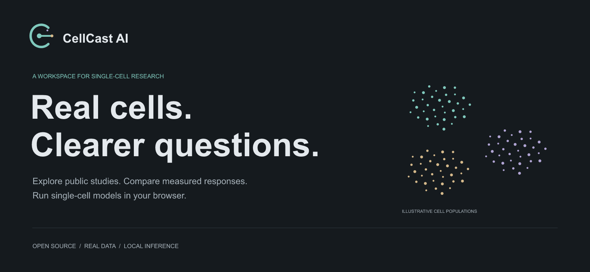
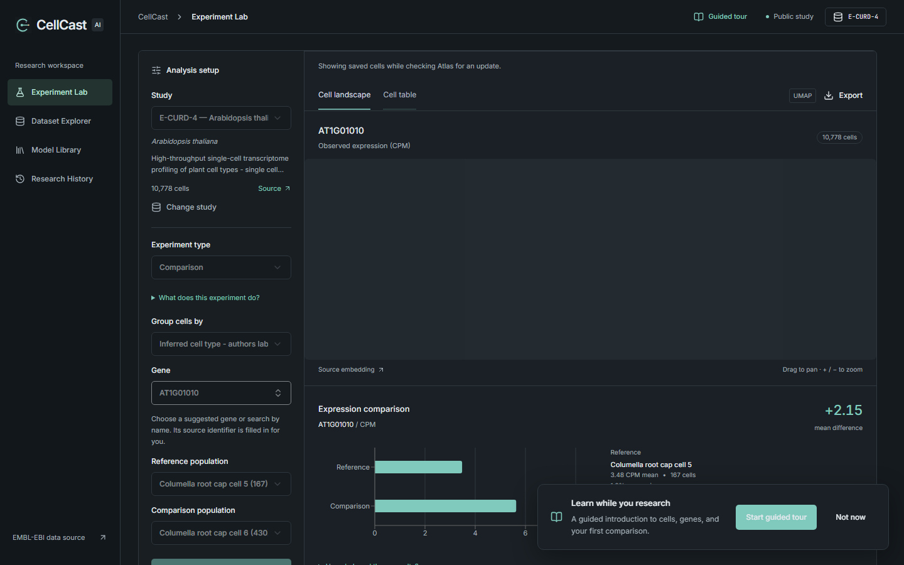
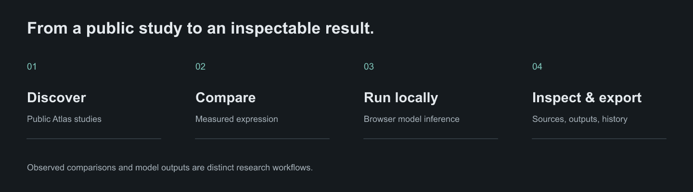

# CellCast AI

**Explore real cells. Compare measured responses. Run models in your browser.**

### [Open the live app → cellcast-taupe.vercel.app](https://cellcast-taupe.vercel.app)

CellCast brings public single-cell studies, gene-expression comparisons, observed perturbation responses, and browser-side model inference into one research workspace. Start with a plant dataset, follow a gene across cell populations, and keep the source behind every result within reach.

[Live app](https://cellcast-taupe.vercel.app) · [Quick start](#run-locally) · [Judge walkthrough](#a-five-minute-walkthrough) · [Model provenance](docs/MODEL-LIBRARY.md) · [Recorded evidence](docs/evidence/research-e2e.json) · [Contributing](CONTRIBUTING.md)



## Why CellCast

Public single-cell data and research models often require separate tools and substantial setup. CellCast makes a first investigation accessible through a browser: find a study, inspect its published embedding, compare measured expression, and review model outputs alongside their provenance.

| Workspace | What you can do today |
| --- | --- |
| **Dataset Explorer** | Browse the live EMBL-EBI Single Cell Expression Atlas catalogue, with plant studies prioritized and filters for study type and perturbation support. |
| **Experiment Lab** | Inspect published embeddings and per-cell measurements; compare gene expression between populations or measured control and treatment/genotype groups. |
| **Model Library** | Run scPlantLLM Arabidopsis embeddings and scGPT Human expression reconstruction in a browser worker using ONNX Runtime Web. |
| **Research History** | Reopen locally saved analyses and export results. |

## A five-minute walkthrough

New to single-cell research? Select **Guided tour** in the app header. Nine spotlight lessons explain studies, cells, genes, measured comparisons, model limits, and research history. Progress saves in this browser; you can pause, resume, or restart. See the [learning tour guide](docs/LEARNING-TOUR.md).

1. Open **Dataset Explorer** and choose Arabidopsis study **E-CURD-4**.
2. In **Experiment Lab**, choose **Comparison**, select **AT3G18780**, and compare two available cell populations. Inspect the embedding, mean expression, and fraction of expressing cells; open the expression source.
3. Choose **E-ENAD-30** and **Perturbation response**. Compare **None** with **17beta-estradiol** under **Compound**. This shows a measured treatment response. **E-GEOD-123013** offers a genetic example with wild type and mutant groups.
4. After preparing model assets, open **Model Library**, select a measured example cell, and run **scPlantLLM Arabidopsis**. Inspect its 512-dimensional embedding, numerical parity check, and export. Try **scGPT Human** for expression reconstruction.
5. Visit **Research History** and reopen an analysis. Reload the page to check persistence.

Upstream studies are live resources, so availability and metadata can change. The [recorded research replay](docs/evidence/research-e2e.json) captures comparisons, chemical and genetic perturbation examples, and six real-cell model runs. Screenshots and other recorded checks live in [docs/evidence](docs/evidence).

## Run locally

Use [Bun](https://bun.sh/) and a current desktop browser. Public dataset exploration needs an internet connection; no API key or account is required.

```sh
bun install --frozen-lockfile
bun run assets
bun run dev
```

Open **http://127.0.0.1:3000**. `bun run assets` copies ONNX Runtime support files from installed dependencies; it does **not** download model weights.

**Model inference requires an extra preparation step locally.** Large ONNX binaries and checkpoints are excluded from Git. Run `bun scripts/deployment-assets.ts` to download SHA-256-verified browser exports from the versioned GitHub release, or follow [Rebuild model assets](docs/REPRODUCIBILITY.md#rebuild-model-assets) to recreate them with Python. Dataset exploration and observed comparisons can be used before preparing those models. See [Vercel deployment](docs/DEPLOYMENT.md) for the automated hosting setup.

## What the models mean

| Model | Browser weights | Current task | Measured example inputs |
| --- | --- | --- | --- |
| scPlantLLM Arabidopsis | 104.23 MB FP32 | 512-dimensional cell embedding | Three cells from E-CURD-4 |
| scGPT Human | 203.46 MB FP32 | Expression reconstruction | Three cells from E-MTAB-7606 |

Inference runs in a browser worker, using WASM by default and optional WebGPU. The examples use shortened gene panels padded to 128 positions. Numerical checks compare the browser output with PyTorch references; they establish conversion consistency, **not biological accuracy**. See [model provenance, hashes, preprocessing, and reproducibility](docs/MODEL-LIBRARY.md).

Observed perturbation responses are descriptive comparisons of published measurements. They do not establish causal effects or statistical significance. Neither current model predicts an unmeasured knockout or drug response. CellOracle is a future integration candidate. CellCast is an exploratory research prototype, not a validated full-transcriptome or clinical analysis pipeline.

## How it works



```text
Atlas JSON ── direct browser fetch ───┐
                                     ▼
Study HTML ── cached configuration ── research workspace
                                     ├── local history / IndexedDB cache
                                     └── browser worker
                                          │
                                 ONNX Runtime Web · WASM / WebGPU
                                          │
                                  inspect and export outputs
```

The interface uses **Next.js, React, TypeScript, shadcn/ui, deck.gl, Recharts, and TanStack Virtual**. The browser fetches the public catalogue, gene suggestions, cell coordinates, and expression directly from Atlas. Only study configuration needs a cached same-origin route because Atlas blocks browser access to its HTML pages. Model inference runs locally in the browser. The application still requires its Next.js server and is not a complete offline application.

## Verify and explore the code

```sh
bun run typecheck
bun run build
bunx playwright install chromium
```

With model assets prepared and the app running, run the research replay in another terminal:

```sh
bun scripts/research-e2e.mjs
```

The replay defaults to port 3001; set `CELLCAST_URL` to your running app URL, for example `http://127.0.0.1:3000`. See [the complete run and reproduction guide](docs/REPRODUCIBILITY.md) for PowerShell syntax.

| Path | Purpose |
| --- | --- |
| `app/` | Research workspace and dataset API routes |
| `components/` | Scientific views, controls, and UI primitives |
| `lib/` | Data access, study classification, storage, and model workers |
| `experiments/` | Pinned model preparation, conversion, and reference checks |
| `public/models/` | Vocabularies, measured profiles, and numerical reports; generated weights stay local |
| `docs/` | [Dataset notes](docs/DATASETS.md), [UI contract](docs/RESEARCH-UI.md), [model documentation](docs/MODEL-LIBRARY.md), and evidence |
| `public/brand/` | Shared CellCast visual assets |
| `design/` | [Editable Pentool sources, palette, and asset-use guide](design/README.md) |

## Open source and credits

Original CellCast application code and original brand assets are available under the [MIT license](LICENSE). Third-party source, model artifacts, and datasets retain their own terms; in particular, the included scPlantLLM material uses **CC BY-NC 4.0**. See [third-party notices](THIRD_PARTY_NOTICES.md) before reusing those materials.

Built on [Single Cell Expression Atlas](https://www.ebi.ac.uk/gxa/sc/home), [scPlantLLM](https://github.com/compbioNJU/scPlantLLM), [scGPT](https://github.com/bowang-lab/scGPT), and [ONNX Runtime](https://onnxruntime.ai/). Contributions are welcome: start with [CONTRIBUTING.md](CONTRIBUTING.md).
